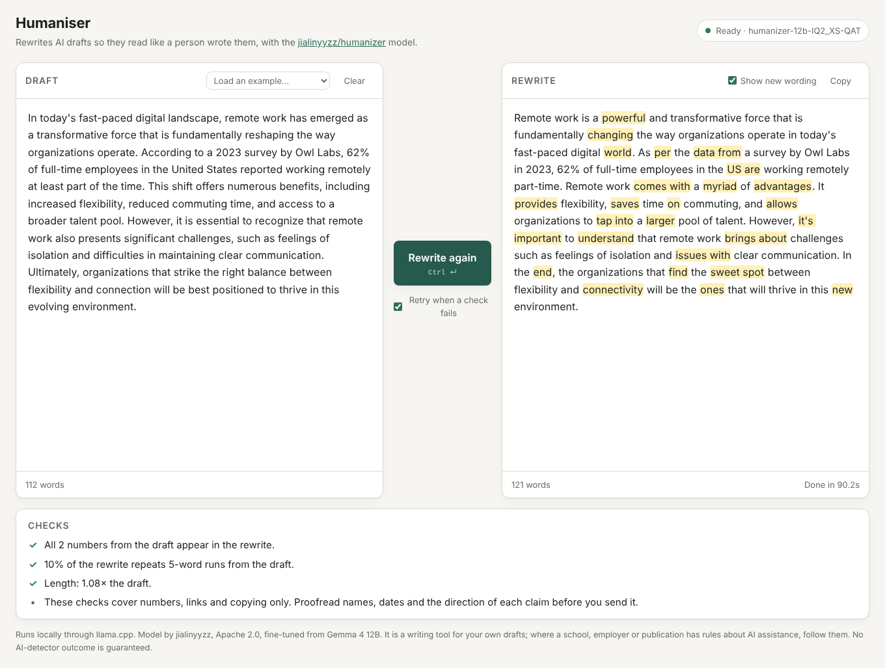

# Humaniser

A local web interface for **[jialinyyzz/humanizer](https://huggingface.co/jialinyyzz/humanizer)**, a 12B model
(fine-tuned from Gemma 4 12B) that rewrites AI-written drafts, in English or Chinese, so they read like a person wrote them.
It is trained to keep every number, unit, date, name and quotation.

Paste a draft, press **Humanize**, and the rewrite streams in next to it. New wording is highlighted, and a checks
panel tells you if a number or link went missing.



## What it does

- **Uses the model the way it was trained.** It is a text-completion model, not a chat model. The interface sends
  the exact training prompt, which is checked against the authors' published fingerprint at import. It also sends
  their sampling settings (temperature 1.0, top-p 0.95, top-k 0, min-p 0, no repetition penalty, no stop strings).
- **Streams** the rewrite token by token. **Stop** (or `Esc`) cancels generation on the server too.
- **Highlights new wording** in the rewrite, and marks in red any number that wasn't in the draft.
- **Checks every rewrite** for missing numbers (`1,250` = `1250`, `480k` = `480000`, "twelve" = `12`), new numbers,
  missing links, copying from the draft, and length.
- **Retries** a piece once when a check fails and keeps the better try. It samples again, up to 3 times, when an
  English draft comes back in Chinese, which the model occasionally does on short informal drafts.
- **Handles long documents.** The model has an 8192-token context and works best on a few hundred words at a
  time. Long drafts are split at paragraph breaks into pieces of about 350 words (600 Chinese characters).
  Markdown headings, code blocks and tables are kept exactly as written.
- Light and dark mode, and it works on a phone-sized screen.

## Quick start

You need Python 3.10+ and [llama.cpp](https://github.com/ggml-org/llama.cpp) (the runtime the model's authors recommend).

```bash
# 1. llama.cpp: provides the llama-server command
brew install llama.cpp            # macOS
winget install llama.cpp          # Windows
# Linux: a prebuilt zip from https://github.com/ggml-org/llama.cpp/releases, or build it:
#   git clone https://github.com/ggml-org/llama.cpp && cd llama.cpp
#   cmake -B build && cmake --build build -j --target llama-server      # add -DGGML_CUDA=ON for NVIDIA

# 2. this interface
git clone https://github.com/pranav20395/humaniser && cd humaniser
python3 -m venv .venv && source .venv/bin/activate     # Windows: .venv\Scripts\activate
pip install -e .

# 3. the model: picks a file that fits your memory and saves it in ./models
python -m humaniser download

# 4. start: launches llama-server with the right flags and serves the interface
python -m humaniser serve --model models/humanizer-12b-Q6_K.gguf       # use the file step 3 printed
```

Open **http://127.0.0.1:8000**. The status pill in the corner shows *Loading model…* until llama-server is ready.

### Which file

`download` picks one by your machine's memory. To choose yourself, use `--quant`:

| `--quant` | Size | Memory | Notes |
|---|---|---|---|
| `Q8_0` | 12.7 GB | 32 GB+ | Best quality, recommended by the authors |
| `Q6_K` | 10.0 GB | 16 GB | No measurable loss |
| `Q4_K_M` | 7.6 GB | ~14 GB | Slight loss |
| `Q3-QAT` | 5.6 GB | 12 GB | A few more fact slips |
| `IQ2_XS-QAT` | 3.9 GB | 8 GB | Smallest (2-bit); more fact slips, so check numbers and names |

With a GPU (Metal on Apple silicon, CUDA, Vulkan) a 100-word email takes a few seconds. On CPU only it is slow.
On a 4-core cloud VM with the 2-bit file, a 100-word draft took 20–90 s.

## Using a server you already run

If the model is already loaded somewhere, point the interface at it instead of passing `--model`:

```bash
# llama-server you started yourself (use -c 8192 -np 1)
python -m humaniser serve --backend-url http://127.0.0.1:8080

# LM Studio, vLLM, or any OpenAI-style server: uses /v1/completions (never chat completions)
python -m humaniser serve --backend openai --backend-url http://127.0.0.1:1234      # LM Studio
python -m humaniser serve --backend openai --backend-url http://127.0.0.1:8000 --port 8001 \
    --api-model jialinyyzz/humanizer                                                # vllm serve ... --generation-config vllm
```

Other options: `python -m humaniser serve --help`. Useful ones are `--host 0.0.0.0` to reach the interface from
another device on your network, `--gpu-layers N` if the model doesn't fit in GPU memory, and `--llama-server PATH`
if `llama-server` isn't on your `PATH`.

Ollama is not supported: it applies its own chat template, which breaks this model.

## Read the result before you send it

From the model card: on the authors' evaluation a strict fact judge found no problem in 376 of 420 English rewrites.
Most problems it did find were a single word or phrase, like "37 complaints" becoming "37% of complaints". The
checks here catch missing numbers and links. They do not catch a changed name, a date written in words, an
invented sentence, or a claim that now points the other way. Chinese rewrites slip more often than English ones.
Formatting (lists, sign-offs) can merge or disappear.

No AI-detector outcome is guaranteed. This is a writing tool for your own drafts: where a school, employer or
publication has rules about AI assistance, follow them.

## Development

```bash
pip install -e ".[test]"
pytest
```

The tests use a fake backend, so they don't need the model. Layout:

| File | What it does |
|---|---|
| `humaniser/prompt.py` | The exact prompt, fingerprint and sampling settings |
| `humaniser/backends.py` | Streaming clients for llama-server `/completion` and OpenAI-style `/v1/completions` |
| `humaniser/chunking.py` | Splits long drafts into pieces, keeps headings/code/tables, joins the result |
| `humaniser/checks.py` | Numbers, links, copy rate, length and language checks |
| `humaniser/rewriter.py` | Runs each piece through the model with checks and retries, as a stream of events |
| `humaniser/server.py` | FastAPI app: the page, `GET /api/health`, `POST /api/rewrite` (server-sent events) |
| `humaniser/launcher.py` | Starts `llama-server` for `serve --model` |
| `humaniser/static/` | The page (plain HTML/CSS/JS, no build step) |

### API

`POST /api/rewrite` with `{"text": "...", "retry": true}` returns `text/event-stream`. Each event is one JSON line:
`start`, `attempt`, `token`, `piece_done`, then `done` with the full `text` and its `checks`, or `error`.
See the docstring in `humaniser/rewriter.py`.

```bash
curl -N http://127.0.0.1:8000/api/rewrite -H 'Content-Type: application/json' \
  -d '{"text": "I hope this email finds you well. The meeting is moved to 3 PM on Friday."}'
```

## Credits

Model: [jialinyyzz/humanizer](https://huggingface.co/jialinyyzz/humanizer) by jialinyyzz, Apache 2.0, fine-tuned
from [google/gemma-4-12B](https://huggingface.co/google/gemma-4-12B). The prompt format, sampling settings, file
recommendations and checks follow the model's documentation. This project is not affiliated with the model's
authors or with Google.
